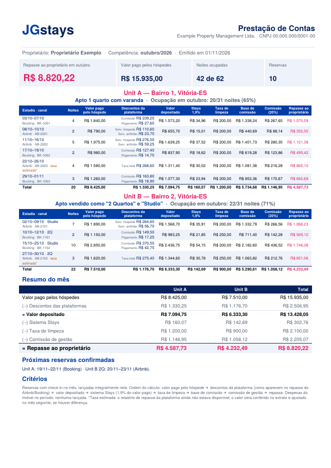
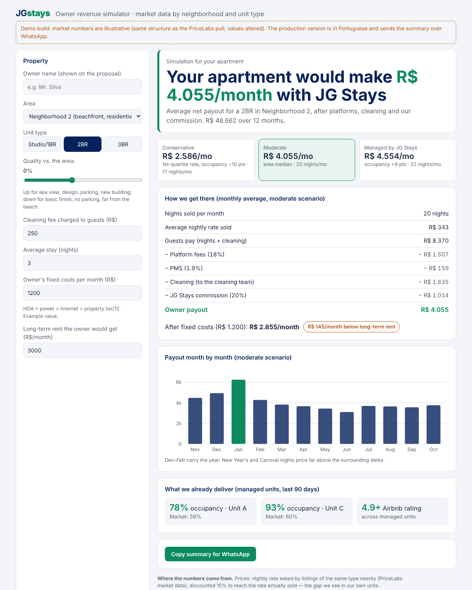
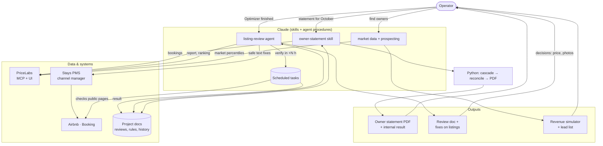

# JG Stays Automation

**AI workflows behind a short-term rental management company, built with Claude.**

JG Stays manages vacation rentals in Vitória, Brazil, on behalf of their owners: listings
on Airbnb and Booking, pricing, guests, cleaning and a monthly payout to each owner, for a
20% fee. It is a small team with 4 live listings and plans to reach 10–15. This repo shows
the workflows that let that team run the business without hiring an operations person per
new property.

> Everything here is anonymized: units are *Unit A/B/C*, owners and guests are fictitious,
> and the example amounts are invented. Grades, rankings and occupancy rates are real.

---

## ★ Featured: Listing Optimizer agent with scheduled verification

PriceLabs grades each listing in 9 categories. The agent reads the report, the screens
and the competitors, then fixes in the PMS whatever is safe to fix and asks about
anything that touches revenue. A few hours later it **schedules its own check** to
confirm the fix actually reached Airbnb and Booking.

| Listing | Optimizer score (29 Oct → 16 Nov 2026) |
|---|---|
| Unit A | 8.7 → **9.4** |
| Unit B · 2BR | 8.9 → **9.2** |
| Unit B · Studio | 8.7 → **8.9** |
| Unit C | 8.6 → **9.2** |

All 4 listings are on page 1 of Airbnb search. Over 4 weeks the agent created 12
scheduled tasks to close the loop.
→ **[listing-optimizer-agent/](listing-optimizer-agent/)**

---

## Automations

| | Workflow | Problem it solves | How automated | Stack |
|---|---|---|---|---|
| ★ | [**Listing Optimizer agent**](listing-optimizer-agent/) | Listing grades drop and fixes don't reach the channels | **Agentic workflow:** Claude + MCP + browser + self-scheduled verification. Human approves anything revenue-related | Claude, PriceLabs MCP, Claude in Chrome, Stays, scheduled tasks |
| 1 | [**Owner reporting**](owner-reporting/) | Monthly payout per owner, every cent explained; internal P&L | **AI-assisted workflow + Python generator:** Claude pulls the data via a skill; code computes, reconciles and renders | Claude skill, PriceLabs MCP, Python, ReportLab, matplotlib |
| 2 | [**Owner acquisition**](owner-acquisition/) | "How much would my apartment make?" and who to ask | **Web tool** (single HTML file) + **AI-assisted research** under written criteria | Claude, PriceLabs market data, HTML/JS |

| Owner statement (fictitious data) | Revenue simulator (demo data) |
|---|---|
|  |  |

## Impact

`TBD` values are being filled in from the operator's own estimates. Formula:
**hours saved per month = (time before − time now) × runs per month.**

| Workflow | Before | Now | Runs / month | Saved / month |
|---|---|---|---|---|
| Owner statement | `TBD` h | `TBD` min | `TBD` | `TBD` h |
| Internal result | `TBD` h | `TBD` min | 1 | `TBD` h |
| Listing review + fixes | `TBD` h per listing | `TBD` min | `TBD` | `TBD` h |
| Post-sync check | `TBD` min | ~0 (scheduled) | `TBD` | `TBD` h |
| Owner revenue estimate | `TBD` min | `TBD` min | `TBD` | `TBD` h |
| Prospect list (60 leads) | `TBD` h | `TBD` h | one-off | `TBD` h |
| **Total** | | | | **`TBD` h/month** |

## Architecture



## Stack

- **Claude**: skills, agent procedures, scheduled tasks, Claude in Chrome for UIs without an API
- **MCP**: PriceLabs (bookings, market data, Listing Optimizer). Read-only by default; writes need approval.
- **Python**: ReportLab and matplotlib for PDFs, pytest for the payout math
- **Platforms**: Stays (PMS / channel manager), Airbnb, Booking.com, PriceLabs
- **Web**: plain HTML/JS for the simulator (no build step, works on GitHub Pages)

## Built with Claude: who did what

The code, prompts and documents were **written with Claude** as the builder. My part:

- **Process design:** what gets automated, where a human must stay in the loop, and
  which checks make each output trustworthy (reconciliation before a PDF exists,
  verification after a sync).
- **Business rules:** the payout cascade and its order, which month a booking belongs
  to, who keeps the cleaning fee, lead criteria, decision tiers for the agent, and the
  compliance limits (no pitching through Airbnb chat, LGPD).
- **Validation:** checking every statement before it goes to an owner, approving or
  rejecting every revenue-affecting change, choosing photos, and running these
  workflows on a real business every week.

## Repo structure

```
jg-stays-automation/
├── README.md
├── docs/
│   ├── case-study.md            problem → solution → result → lessons
│   └── img/
├── listing-optimizer-agent/     ★ featured
│   ├── README.md
│   ├── prompts/                 agent procedure + verification task template
│   └── examples/                input report → review doc, scheduled tasks
├── owner-reporting/
│   ├── README.md
│   ├── SKILL.md                 the Claude skill
│   ├── src/                     cascade, owner statement, internal result
│   ├── tests/
│   └── examples/                fictitious month (JSON) → PDFs
└── owner-acquisition/
    ├── README.md
    ├── simulator/index.html     revenue simulator (demo data)
    └── prospecting/             criteria + outreach templates (no scraping code)
```

## Privacy

No owner or guest names, tax IDs, phone numbers, e-mails, listing IDs, addresses, real
payout or commission amounts, or credentials. Lead-collection code and lead lists are
deliberately not published.

## Roadmap

- **v2: booking analytics.** Channel mix and booking lead-time curves feed a last-minute
  pricing method (checkpoints at D-7/D-3/D-1). Already in use as an analysis, not yet packaged.
- **Guest-messaging copilot.** Draft-only replies for WhatsApp, the largest manual workload left.
- Read platform payout exports automatically, so fees are never estimated.

## License

MIT. See [LICENSE](LICENSE).
