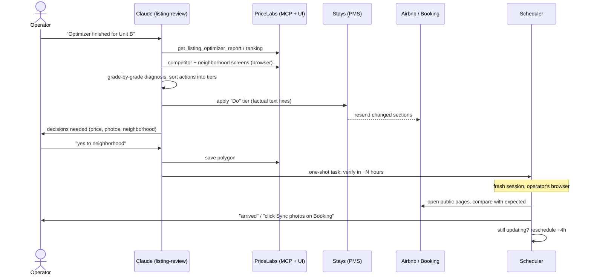

# Listing Optimizer agent + scheduled verification

**Type:** agentic workflow. Claude uses the PriceLabs MCP, the operator's browser and
the PMS, then schedules its own follow-up check.  
**Runs:** after each Listing Optimizer run (4 listings) and after any listing change  
**Status:** in production since Oct 2026

## Problem

Each listing gets graded in 9 categories (title, photos, description, amenities,
reviews, consistency...) by PriceLabs' Listing Optimizer. The report says *what* is
wrong. Acting on it means:

1. reading every grade and competitor in a UI the API only partly exposes;
2. editing the listing in the PMS (Stays), which syncs to Airbnb and Booking;
3. **checking hours later that the change actually reached each channel.** Sync is
   asynchronous and fails silently (expired token, section not resent, Booking
   ignoring PMS text).

Step 3 is the one that gets forgotten. A fix that never reached Airbnb is the same as
no fix, and the next Optimizer run grades the old listing again.

## How it works

### Human in the loop by design

| Tier | Who decides | Examples |
|---|---|---|
| **Do** | Agent | Factual text fixes the operator already confirmed, resend to channels, review doc, schedule verification |
| **Propose** | Operator says "yes" | Price, minimum stay, neighborhood, competitor list, title rewrite |
| **Operator only** | Operator | Cover + top-5 photos (agent sends numbered options), extranet logins |
| **Never** | — | Guest messages, deleting content, inventing property facts |

The PriceLabs connection is **read-only by default**. Write access exists, but it only
runs after an explicit "yes", because it changes live prices.

## Results (real, Oct 29 → Nov 16, 2026)

| Listing | Optimizer score | What moved |
|---|---|---|
| Unit A | 8.7 → **9.4** | Title C → B · Consistency B → A |
| Unit B · 2BR | 8.9 → **9.2** | Title B → A |
| Unit B · Studio | 8.7 → **8.9** | Consistency B → A (capacity fixed to match photos) |
| Unit C | 8.6 → **9.2** | Title C → B · Description B → A |

- All 4 listings on **page 1** of Airbnb search (weekly Optimizer e-mail, 3 Nov).
- In the competitive sets, the strongest comps score 6.4–9.1.
- **12 scheduled tasks** in 4 weeks: 6 post-sync verifications, plus follow-ups that
  wait for PriceLabs/Booking recalculation windows instead of the operator.

*Caveat: the scores also depend on facts and photos the operator provided. The
agent's job was finding what to fix and making sure the fix landed. No causal claim
is made about bookings.*

## Files

| Path | What it is |
|---|---|
| [`prompts/listing-review.md`](prompts/listing-review.md) | The agent procedure as a reusable skill: tools, decision tiers, steps, output format |
| [`prompts/post-sync-verification.md`](prompts/post-sync-verification.md) | Template + rules for the scheduled verification task |
| `examples/input/optimizer_report_unit-b-2br.json` | What the agent reads (reduced, anonymized) |
| `examples/output/review_unit-b-2br_2026-11-16.md` | The review doc it wrote (translated, anonymized) |
| `examples/output/scheduled_tasks.md` | The 12 tasks it scheduled, and one full prompt |

## What is still manual

- Choosing photos (taste, and the operator wants to pick them).
- Price decisions.
- Booking extranet: the agent can't log in, so the operator does.

## Impact

| | Before | Now |
|---|---|---|
| Review + fixes per listing | `TBD` h (or "not done") | `TBD` min |
| Post-sync check | `TBD` min each | ~0 (scheduled) |
| Volume | `TBD` runs/month · `TBD` checks/month | same |

*Time figures are the operator's own estimates (see the root README).*

## Lessons

- **"Done" means verified on the channel, not saved in the PMS.** Most wasted effort
  came from fixes that never synced.
- **Scheduled tasks need observable checks** ("first photo id is X"), not intentions
  ("photos updated").
- **Tiers beat confirmations.** Asking about everything trains the operator to click
  "yes". Asking only about revenue-affecting changes keeps the "yes" meaningful.
- **The API is not the whole product.** Half of the Optimizer's value (selling points,
  competitor overview) only exists on screen, so the agent reads the UI too.
