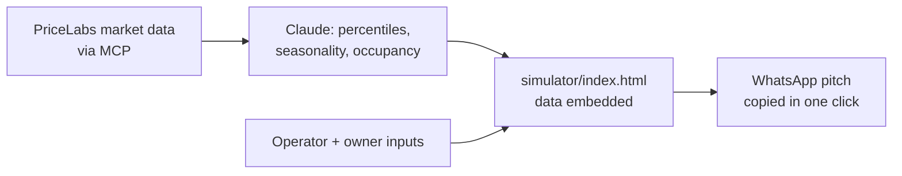

# Owner acquisition: revenue simulator + prospecting playbook

**Type:** web tool built with Claude (simulator) + AI-assisted research (prospecting)  
**Runs:** the simulator for every lead; prospecting in batches  
**Status:** simulator in use since Nov 2026; first prospect list delivered 15 Nov 2026

## Problem

A management company grows by signing owners. Owners ask one question: *"How much
would my apartment make with you?"* Answering it used to take a spreadsheet, market
guesses and a day of back-and-forth. The second problem is knowing who to ask at all.

## 1. Revenue simulator

**[`simulator/index.html`](simulator/index.html)** is a single file with no build step.
It opens in any browser, and GitHub Pages can serve it as a live demo.

- **Inputs:** area, unit type, quality vs. the area, cleaning fee, average stay, the owner's
  fixed costs, the long-term rent they'd get otherwise.
- **Output:** monthly net payout in 3 scenarios (conservative / moderate / managed), the
  full deduction cascade, a 12-month seasonality chart, a comparison with long-term rent,
  and a **"Copy for WhatsApp"** button that writes the pitch.
- **Data:** PriceLabs market data per area (rate percentiles per unit type, market
  occupancy and price index per month), pulled by Claude through the PriceLabs MCP.
  **In this repo the numbers are illustrative.** The structure is real; the values were changed.
- **Same rules as the owner statement:** platform fees → PMS → cleaning → 20% commission.
  A prospect sees the same math they'll later get in their monthly statement.

## 2. Prospecting playbook

- **[`prospecting/criteria.md`](prospecting/criteria.md)**: who counts as a lead, A/B/C
  priority, exclusions, and the compliance rules (no pitching through the Airbnb chat,
  no cross-referencing names under LGPD).
- **[`prospecting/outreach-templates.md`](prospecting/outreach-templates.md)**: the 5
  messages the operator sends, from first contact to the front-desk route.

**Not published:** the collection code and the lead list. They contain real people's
data and ran in the operator's own browser session. The criteria are the reusable part.

Result: 276 Airbnb listings screened + OLX/Marketplace → **60 qualified owners** in two
prioritized lists, 9 iterations with the operator.

## What is still manual

- All contact with owners (templates are copied, never auto-sent).
- Marketplace collection needs the operator's own signed-in account.
- Market data exists for 2 areas only. Elsewhere the simulator relies on the quality slider
  and says so.

## Impact

| | Before | Now |
|---|---|---|
| One owner estimate | `TBD` min (or "not done") | `TBD` min · `TBD` per month |
| 60-lead list | `TBD` h by hand | `TBD` h with Claude |

*Time figures are the operator's own estimates (see the root README).*
