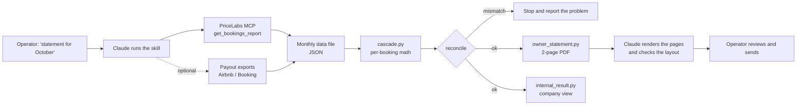

# Owner reporting: monthly statement + internal result

**Type:** AI-assisted workflow (Claude + PriceLabs MCP) + Python generator  
**Runs:** monthly, one statement per owner + one internal report  
**Status:** in production since Sep 2026

## Problem

Every month each owner needs to know exactly how much they get and why. The math
is a cascade with several parties taking a cut (Airbnb/Booking, the PMS, cleaning,
the manager), the data is spread across PriceLabs, Stays and platform payout
reports, and one wrong cent costs trust. Done by hand it is slow, and the work grows
with every new owner.

## How it works



1. **Claude, through the skill** ([`SKILL.md`](SKILL.md)), pulls the month's bookings
   from PriceLabs (by check-in date, cancellations included for checking) and writes
   the monthly data file.
2. **`cascade.py`** applies the business rules to each booking:
   guest paid → platform deductions (itemized) → deposited → PMS fee → cleaning →
   commission base → commission → owner payout.
3. **`reconcile()`** blocks the PDF if any step doesn't close to the cent, or if the
   sum of payouts differs from the headline number.
4. **`owner_statement.py`** builds the owner PDF; **`internal_result.py`** uses the same
   numbers to answer how much the company made.
5. Claude renders the pages to images, checks them and hands the PDF over with a short
   note on what is estimated.

## What is still manual (on purpose)

- **Platform payout exports.** PriceLabs doesn't return platform fees, so without the
  Airbnb/Booking exports the fees are estimated. Those bookings are flagged in the PDF
  ("taxa estimada*").
- **Final review and sending** to the owner.
- **Business rules** (commission %, who keeps the cleaning fee, which month a
  booking belongs to) were decided by the operator. The code only applies them.

## Try it

```bash
pip install -r requirements.txt
cd src
python owner_statement.py ../examples/input/2026-10.json owner-01
python internal_result.py ../examples/input/2026-10.json
cd .. && pytest -q
```

## Files

| Path | What it is |
|---|---|
| `SKILL.md` | The Claude skill (English adaptation of the production one) |
| `src/cascade.py` | Payout cascade + reconciliation (pure functions, tested) |
| `src/owner_statement.py` | Owner PDF: month detail + year view |
| `src/internal_result.py` | Company PDF: commission + cleaning + owned unit |
| `src/layout.py` | Shared PDF blocks (header, tables, calendar, charts) |
| `examples/input/2026-10.json` | **Fictitious** month, same shape as the real input |
| `examples/output/*.pdf` | PDFs generated from the example |
| `tests/test_cascade.py` | Cascade order, owned-unit rule, reconciliation |

> The PDFs are in Brazilian Portuguese because owners read them. Code and docs are in English.

## Impact

| | Before | Now |
|---|---|---|
| Owner statement | `TBD` h per statement | `TBD` min |
| Internal result | `TBD` h | `TBD` min |
| Volume | `TBD` statements/month | same |

*Time figures are the operator's own estimates (see the root README).*
